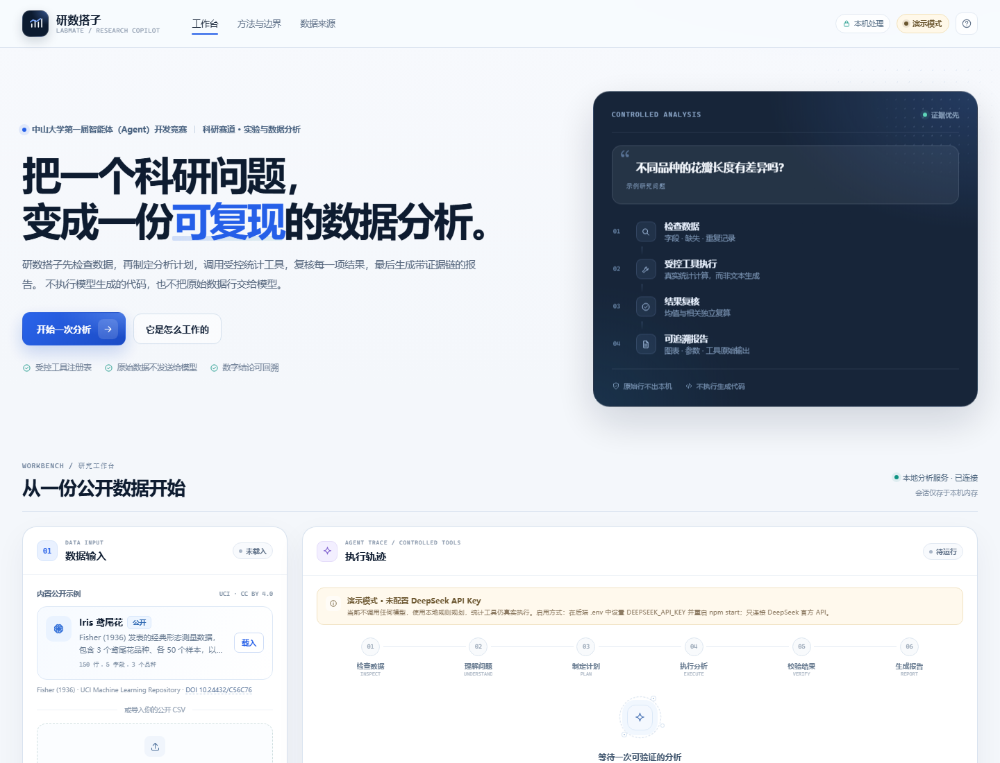
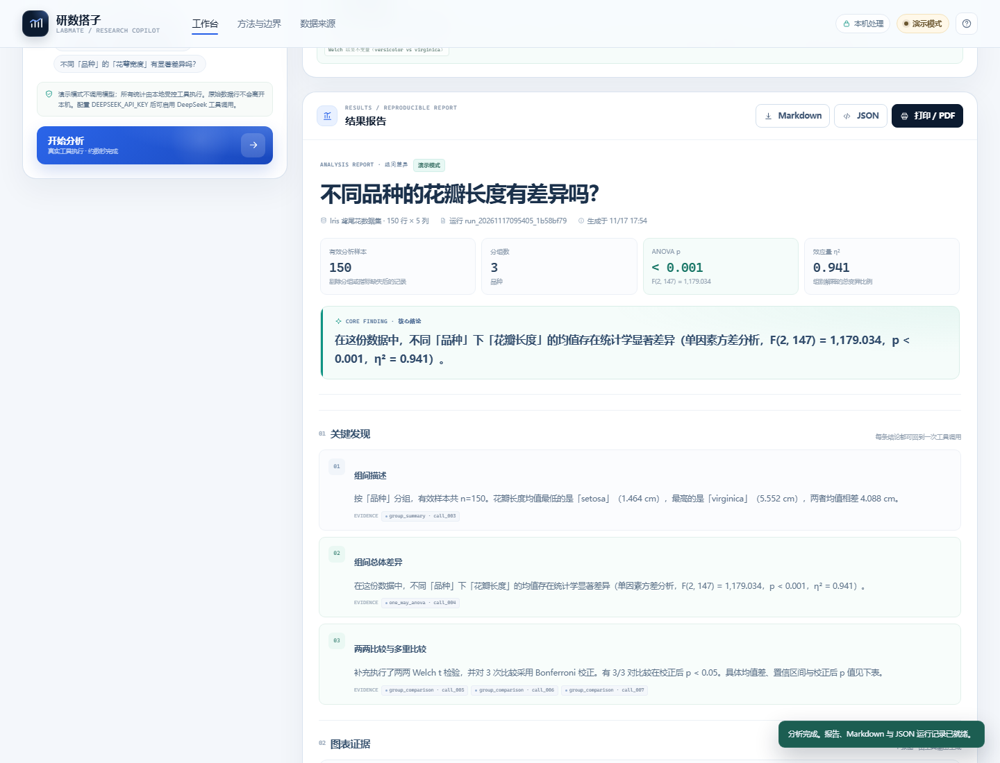

# 研数搭子 LabMate

> 把一个科研问题，变成一份可复现的数据分析。

面向刚开始做科研、需要分析实验数据的本科生和研究生。用户选择一份公开 CSV、写下一个可检验的问题，Agent 会依次检查数据、理解问题、制定计划、调用真实统计工具、校验结果并生成带证据链的报告。

本项目是中山大学第一届智能体（Agent）开发竞赛 · 科研赛道（实验与数据分析）的参赛作品。





## 快速启动

要求：Node.js ≥ 22（无需数据库、无需 Docker、无第三方运行时依赖）。

**Windows 最简单方式**：双击项目根目录的 `start-labmate.cmd`，它会检查 Node.js、启动服务并打开浏览器。

命令行方式：

```bash
cd labmate
npm start
```

打开 **http://127.0.0.1:4173**。不需要先执行 `npm install`。

开发模式（改动服务端文件自动重启）：

```bash
npm run dev
```

健康检查：`GET /api/health`。默认只监听 `127.0.0.1`；如需局域网演示，可设置 `HOST=0.0.0.0`，但不要把本版直接暴露到公网。

## 三分钟演示路径

1. 打开工作台，点击内置的 **Iris 鸢尾花数据集 → 载入**。
2. 点击推荐问题 **“不同品种的花瓣长度有差异吗？”**，或直接输入。
3. 点击 **开始分析**。
4. 查看执行轨迹：每一步的状态、调用的工具、参数、耗时与原始 JSON 输出。
5. 查看结果报告：核心结论、关键指标、箱线图、分组统计、ANOVA、两两 Welch 比较与多重比较校正。
6. 展开 **运行证据**；尝试 **导出 Markdown**、**导出 JSON**、**打印 / PDF**。
7. 再试一个不支持的问题（例如“不同品种对花瓣长度有因果影响吗？”），确认界面明确解释边界而不是编造结论。

更完整的 3 分钟讲解稿与 2 分钟答辩问答见 [docs/DEMO-SCRIPT.md](docs/DEMO-SCRIPT.md)。

## 功能

- **数据输入**：内置 UCI Iris 公开数据；导入 UTF-8、逗号分隔 CSV；表格预览、行/列数、字段类型、缺失率、重复行、基础分布与字段质量弹窗。高基数文本字段的单元格取值不会进入报告或运行记录。
- **严格输入检查**：空文件、仅表头、重复/空列名、非法控制字符、字段数不一致、未闭合引号、全空列、超大文件等均返回可理解的中文提示。
- **六步 Agent 工作流**：检查数据 → 理解问题 → 制定计划 → 执行分析 → 校验结果 → 生成报告。
- **真实统计工具**：所有结果由 Node 内置统计实现计算；没有“看起来像分析”的生成文本。
- **受控工具注册表**：模型只能选择已注册工具、合法字段和参数；工具名、列引用、分组取值、参数白名单都会校验。任何模型生成的 Shell / Python / JavaScript 都不会执行。
- **演示模式**：没有配置 `DEEPSEEK_API_KEY` 时，使用本地确定性规则规划，界面明确标注“演示模式”并提示配置方法，工具依旧真实执行。
- **DeepSeek 工具调用模式**：只连接 DeepSeek 官方 API；DeepSeek 通过原生 `tool_calls` 选择分析工具，后端逐项校验工具名、列名与参数后才执行。模型失败或工具调用不合法时透明回退到本地规则，运行记录保留模型名、官方端点与 token 用量。
- **结果复核**：独立复算分组均值、Welch 比较不变量与 Pearson 相关系数，并检查 p 值、置信区间、样本量与计划完整性。
- **可追溯报告**：关键发现带证据 ID；报告包含数据质量、方法、样本量、图表、统计表、局限性与数据来源；可下载 Markdown / JSON，并可用浏览器打印为 PDF。
- **状态完整**：空状态、上传中、Agent 运行中、成功、失败、DeepSeek 调用失败后的本地回退都有明确 UI。

## DeepSeek 配置

本产品**只连接 DeepSeek 官方 API**，端点固定为 `https://api.deepseek.com/chat/completions`，不提供其他厂商或国外模型的 base URL 配置。后端从环境变量读取 API Key。

在 `labmate/` 下复制环境变量模板：

```bash
cp .env.example .env
```

填写：

```dotenv
DEEPSEEK_API_KEY=sk-your-key-here
DEEPSEEK_MODEL=deepseek-flash
```

`DEEPSEEK_MODEL` 可选，默认为 `deepseek-flash`；请使用 DeepSeek 官方支持 tool calls 的模型。生产环境也可以用进程环境变量注入：

```powershell
$env:DEEPSEEK_API_KEY = 'sk-...'
$env:DEEPSEEK_MODEL = 'deepseek-flash'
npm start
```

可选：`DEEPSEEK_TIMEOUT_MS`（默认 30000，最小 5000）、`PORT`（默认 4173）、`HOST`（默认 127.0.0.1）。

API Key 只保存在后端内存中，不会返回给前端、写进报告或运行记录。**模板里的 `sk-your-key-here` 会被识别为未配置**，不会被视为有效 Key；请自行到 DeepSeek 平台创建并替换。配置后页面顶部显示 **DeepSeek 工具调用模式**，首次分析时才会真正调用官方 API 验证密钥。

### 无 API Key 时如何演示

不需要任何密钥。默认就是演示模式：

- 顶部模式徽章、轨迹区和报告都会明确写出“演示模式”，并提示在后端 `.env` 配置 `DEEPSEEK_API_KEY` 后重启；
- 本地规则负责把问题映射到受控工具与字段；
- 统计、校验、图表、报告全部真实执行；
- 不会发起模型请求，不会伪装成 DeepSeek 回答，也不会伪造工具步骤。

### DeepSeek 如何参与

启用后，DeepSeek 官方 API 调用方式是 Chat Completions + function/tool calling：

1. 后端将研究问题、字段名/类型/缺失率/可分组字段聚合概况，以及允许的 4 个分析工具 JSON Schema 发给 DeepSeek；
2. DeepSeek 返回 `tool_calls`（如 `group_summary`、`one_way_anova`、`correlation_analysis`）；
3. 后端校验工具名是否在允许列表、参数是否为合法 JSON 对象、字段是否存在且类型正确、分组取值是否真实存在、是否出现多余参数；
4. 只有通过校验的工具才会由本项目后端真正执行；
5. 报告和统计数字由工具输出确定性生成，不采用 DeepSeek 生成的结果数值或结论。

模型只接收研究问题、字段结构、缺失率和聚合概况。**不发送原始 CSV 行、预览行、运行记录全文或数据库。** 工具执行结果也不回传给模型用于生成数字。

DeepSeek 官方 tool calls 文档：<https://api-docs.deepseek.com/guides/tool_calls>；API 参考：<https://api-docs.deepseek.com/api/create-chat-completion>。

## 受控工具

| 工具 | 作用 | 关键参数 |
| --- | --- | --- |
| `profile_dataset` | 数据规模、字段类型、缺失率与基础分布 | 无 |
| `missingness_report` | 缺失单元格、完整行、重复行、零变异字段 | 无 |
| `group_summary` | 按分组计算 n、均值、标准差、中位数、Q1–Q3、范围 | `groupBy`, `metric` |
| `group_comparison` | 两组 Welch 双侧 t 检验、均值差 95% CI、Cohen's d | `groupBy`, `metric`, `groupA`, `groupB` |
| `one_way_anova` | 两组及以上单因素方差分析（本版额外提供） | `groupBy`, `metric` |
| `correlation_analysis` | 2–8 个数值字段的 Pearson / Spearman 相关与 p 值 | `fields[]` |

工具参数必须通过白名单校验；列名会解析为真实字段；分组取值必须真实存在；不支持的工具、多余的参数和模型返回的任意代码都会被拒绝。

## CSV 格式与边界

- 唯一支持的上传格式：UTF-8 编码、逗号分隔的 `.csv`。
- 单文件最大 **5 MB**、最多 **20,000 行**、**80 列**；建议演示数据远小于上限。
- 第一行是表头；列名必须唯一、非空、不能含不可见控制字符。
- 缺失值识别包括空字符串、`NA`、`N/A`、`null`、`NaN`、`缺失` 等；数值字段必须全部能解析为数字，否则按文本/分类字段处理。
- 原始 CSV 只存在当前 Node.js 进程内存中，不写入磁盘；服务重启即清空。上传数据约 2 小时后或超过 12 份时清理；运行记录保留约 24 小时或最多 100 次。
- 不做 PDF 论文解析、任意网页搜索、登录、多用户、数据库、云端文件存储、因果推断、回归、预测、时间序列、聚类等。问题超出范围时会明确说明原因，不会猜测结果。

## 数据处理与安全

- 服务默认只监听 `127.0.0.1`；无账号体系，适合单机演示。
- 原始数据行不会进入模型请求、报告 Markdown 或 JSON 运行记录；运行记录只保留字段结构、分组标签、聚合统计、工具参数、真实输出和证据。高基数文本字段只记录缺失/唯一值等概况，不导出单元格取值。
- Markdown 导出会中和用户问题、列名与数据标签中的 HTML/Markdown 结构字符，避免导出文件被用于远程跟踪图片或伪造结构。
- 不执行任何模型生成的代码；没有 `eval`、动态导入或任意脚本执行入口；模型返回的 `tool_calls` 只作为选择工具的依据。
- 模型端点硬编码为 DeepSeek 官方 API，不读取自定义 base URL，无法切换到国外模型端点。
- API 有请求体大小限制、CSV 行列上限、字段名校验、路径白名单和基础安全响应头。
- 报告渲染对所有动态文本做 HTML 转义；图表由服务端固定模板生成，并对标签做 XML 转义。
- 仅支持公开、非涉密 CSV。Iris 示例不含个人隐私。

## 报告、导出与复现

一次运行会保留：

- 用户问题、数据来源与字段摘要；
- 六步 Agent 状态与耗时；
- 每次工具调用的 ID、工具名、实际参数、状态、耗时与真实输出；
- 校验检查项；
- DeepSeek 模式下的官方端点、模型名与 token 用量（若模型已返回）；
- 报告、图表、表格、局限性与数据指纹（SHA-256）。

导出：

- **Markdown**：`GET /api/runs/:runId/report.md`，内嵌 SVG 图表，含来源、许可、方法、工具记录与局限性。
- **JSON**：`GET /api/runs/:runId/record.json`，完整运行记录，不含原始数据行。
- **打印 / PDF**：报告页使用专用打印样式；浏览器打印时隐藏工作台输入区，展开运行证据，保留结论、图表、表格、来源与校验。

仓库内附一份由浏览器打印生成的演示导出：[sample-report.pdf](docs/assets/sample-report.pdf)（5 页）。

## 示例数据来源

内置示例为 **Iris**（UCI Machine Learning Repository，Dataset 53）：

- 官方页面：<https://archive.ics.uci.edu/dataset/53/iris>
- 数据 DOI：<https://doi.org/10.24432/C56C76>
- 许可：**CC BY 4.0**，<https://creativecommons.org/licenses/by/4.0/>
- 引用：Fisher, R. (1936). Iris [Dataset]. UCI Machine Learning Repository. <https://doi.org/10.24432/C56C76>
- 本项目仅添加英文列名 `sepal_length,sepal_width,petal_length,petal_width,species`，并把类别标签映射为 `setosa/versicolor/virginica`；未修改测量值。
- 已知注意事项：UCI 页面说明其 `iris.data` 与 Fisher (1936) 论文有 2 条记录差异；本项目保留 UCI 原值，并在报告中提示。
- 数据文件 SHA-256：`c52742e50315a99f956a383faedf7575552675f6409ef0f9a47076dd08479930`。

更完整的核验记录（官方下载源、许可原文、校验命令、原始 ZIP 哈希、差异记录）见 [data/SOURCE.md](data/SOURCE.md)。

## 测试与验证

```bash
npm test
npm run test:smoke
```

2026-11-17 的交付验证结果：

- `npm test`：**42 项通过，0 失败**（统计引擎、CSV、受控工具、规划器、Agent、DeepSeek 官方端点/tool calls 请求格式、参数拒绝与回退、缺少或占位 API Key 时不发请求、HTTP API）。
- `npm run test:smoke`：启动真实本地服务，载入 Iris，执行组间分析，验证 Markdown / JSON 导出不含原始数据行。
- 使用本机 Chrome 实际验收：示例数据载入、研究问题输入、完整 Agent 执行、报告渲染、上传 CSV 分析、非法 CSV 错误、因果问题拒绝、移动端布局与浏览器打印 PDF。
- 浏览器控制台无错误。

如果运行环境禁止 Node test runner 创建子进程（Windows 受限沙箱可能报 `spawn EPERM`），使用：

```powershell
$env:NODE_OPTIONS='--test-isolation=none'
npm test
```

## 目录结构

```text
labmate/
├── start-labmate.cmd       # Windows 双击启动脚本
├── server.mjs              # 零依赖 HTTP 服务、API、静态资源、导出
├── lib/
│   ├── csv.mjs             # RFC4180 风格 CSV 解析与中文错误
│   ├── dataset.mjs         # 类型推断、缺失/重复/字段概况
│   ├── stats.mjs           # t / F / 相关 / 描述统计纯函数
│   ├── tools.mjs           # 受控工具注册表、参数/字段校验
│   ├── planner.mjs         # 本地规则规划与不支持问题拦截
│   ├── llm.mjs             # DeepSeek 官方 API + 原生 tool calls 适配层
│   ├── agent.mjs           # 六步编排、工具执行、独立复核
│   ├── charts.mjs          # 服务端 SVG 箱线图/热图/散点图
│   ├── report.mjs          # 报告、Markdown、运行记录
│   └── format.mjs          # 数值与 p 值格式化
├── public/                 # 原始 HTML/CSS/JS（无构建步骤）
├── data/
│   ├── iris.csv            # 公开示例数据
│   └── SOURCE.md           # 来源、许可、DOI、校验、SHA-256
├── test/                   # 42 项 node:test 测试
├── scripts/smoke.mjs       # 真实服务烟雾测试
├── docs/
│   ├── DEMO-SCRIPT.md      # 3 分钟演示 + 2 分钟答辩
│   └── COMPETITION-CHECKLIST.md
├── .env.example
└── package.json
```

## 当前限制与尚未完成的事项

- DeepSeek 模式已通过 **mock 的官方 API tool_calls 响应**验证：固定端点、固定工具集、参数校验、非法参数回退、token 用量、缺 Key 时不发请求。仓库中没有真实 DeepSeek API Key，交付环境未调用真实模型；正式演示前若需要 DeepSeek 模式，请配置 `DEEPSEEK_API_KEY` 并用真实账户做一次端到端确认。
- 当前 DeepSeek 请求使用 `deepseek-flash`（支持 function calling）；`DEEPSEEK_MODEL` 可覆盖为其他官方工具调用模型。若官方模型/API 变更，以 DeepSeek 文档为准。
- DeepSeek 只负责工具选择；工具执行结果不会回传给模型，因此报告中的统计结论不依赖模型文字。
- 本版只支持一组“分类字段 × 数值字段”的组间比较，以及至多 8 个数值字段的相关分析；不支持多指标回归、因果推断、预测或复杂建模。
- 两两比较最多覆盖 3 个分组，使用 Bonferroni 校正；分组更多时只做总体 ANOVA，并明确提示未做事后比较。95% CI 未做多重比较校正。
- 不自动做正态性、方差齐性、异常值影响或缺失机制检验；报告中会把这些作为局限性，而不是自动给结论。
- 未实现登录、多用户、数据库、云端持久化、PDF 论文解析、网页搜索。
- 竞赛作品说明 PDF 的团队信息页、成员签名、原创承诺书需要参赛团队亲自填写和签署；本仓库提供产品与演示材料，不代替报名或提交。提交前请按 [docs/COMPETITION-CHECKLIST.md](docs/COMPETITION-CHECKLIST.md) 核对。
